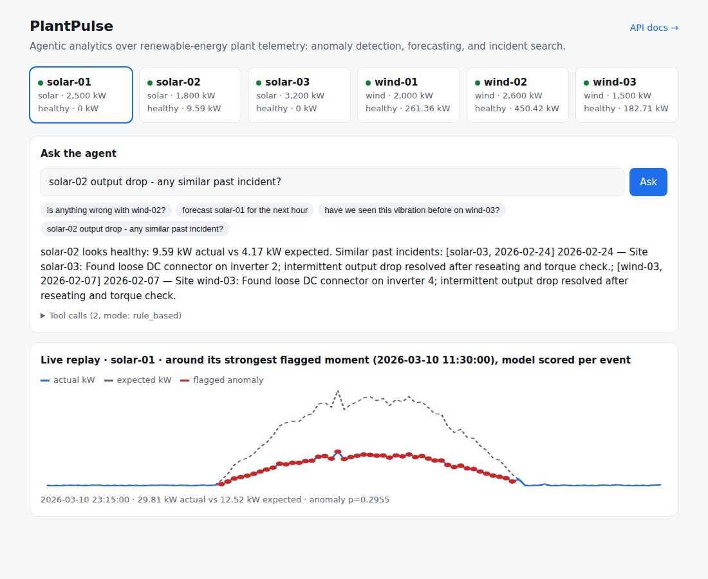
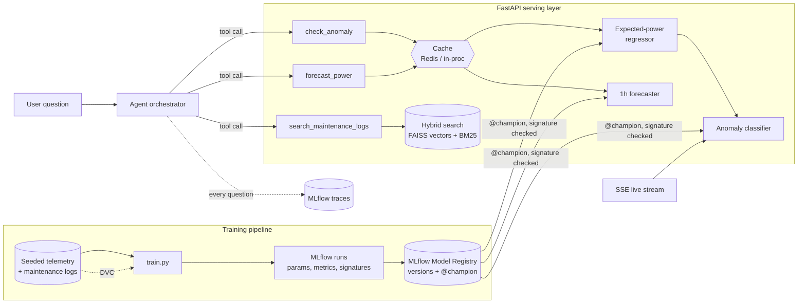

# PlantPulse

**An agentic analytics service over renewable-energy plant telemetry.** Ask a question in plain English ("is anything wrong with wind-02, and have we seen it before?"). An agent routes it to production ML components (an anomaly detector, a 1-hour power forecaster, and semantic search over past maintenance logs) and answers with a full trace of the tool calls it made.

The focus is the engineering around the models rather than the models themselves: serving, latency, caching, provenance, evaluation gates, and CI/CD. The domain draws on my background building SCADA commissioning and network-management systems for solar and wind plants.



*The live replay above shows an inverter fault: actual output (blue) tracks about half the expected curve (dashed) all day, and the model flags each affected reading (red) as it streams.*

---

## Architecture



Anomaly detection is **two-stage**. A regressor learns what a *healthy* site should produce given weather and sensor inputs. A classifier then works on the residual (actual minus expected) together with drift and vibration features. This structure is what lets the system separate real faults from **grid curtailment**, where output is low on purpose. A naive "power dropped" rule can't make that distinction.

## Measured results

All numbers come from a held-out, time-based split (the last 20% of the timeline, so no future data leaks into training). Each one is re-checked by the regression gate on every CI run.

| Component | Model | Naive baseline | Lift |
|---|---|---|---|
| Anomaly detection | **F1 0.666** (P 0.81 / R 0.57, ROC-AUC 0.80) | static threshold rule: F1 0.177 | **3.8x F1** |
| 1-hour power forecast | **MAE 54 kW** | persistence ("next = now"): MAE 143 kW | **62% lower error** |
| Expected-power model | MAE 17 kW on 1.5–3.2 MW sites | – | – |

| Serving performance | Before | After | Change |
|---|---|---|---|
| `predict_anomaly` p50 latency | 73 ms | **~10 ms** | 7x faster: per-site index + `n_jobs=1` for single-row inference |
| `predict_anomaly` p95 latency | 89 ms | **~15–17 ms** | |
| Batch re-scoring (69k rows) | 94 rows/s (row loop) | **85k rows/s** (vectorized) | ~900x |
| …plus 2-process pool | | 98k rows/s | 1.14x more (bounded by 2 cores and IPC overhead) |

The regression check caught the latency problem and a real agent-routing bug ("have we seen this *vibration* before" wasn't reaching log search). Both were fixed, and the fixes are locked in as tests.

## How this maps to the role

| Responsibility | Where it lives |
|---|---|
| Integrate ML into production pipelines and APIs | `app/` FastAPI service; models load once at startup from the MLflow Model Registry (`@champion`), after a signature check |
| Optimize latency, throughput, memory | Measured latency fix above; `ml/benchmark_parallel.py` (naive vs vectorized vs process pool, results asserted identical) |
| Model-serving infrastructure (API, batch, streaming) | REST endpoints, `/predict/batch`, and **SSE `/stream/telemetry`** running live per-event inference |
| Testing and validation frameworks for ML | `tests/`: feature-skew, leakage, API-contract, registry/promotion, agent and tracing, retrieval citation and verifier, session and MCP tests (83) |
| Caching and provenance for models, code and data | Redis/in-process prediction cache; **DVC** for data and artifacts; **MLflow** runs tagged with data hash and git commit, models logged with signatures, `/health` reports which registry version and run each served model came from |
| CI/CD for model deployment | `.github/workflows/ci.yml`: rebuild from source, then tests, then regression gate, then image build and container smoke test, then deploy |
| Regression testing to monitor the analytics engine | `ml/regression_check.py`: quality, p95 latency, agent-routing accuracy, retrieval quality and data contract against a committed baseline, with run history for trends |
| Vector DBs / embeddings / RAG | Hybrid search (FAISS vectors + BM25, fused with RRF) with a per-site filter; bge-small embeddings; answers cite log ids, checked against what was retrieved |
| Agent layer integration | `agent/`: Anthropic tool-use loop, plus a deterministic fallback that calls the *same* tools; a **plan → execute → verify** pipeline with an independent verifier; every question is an **MLflow trace** |

## Run it

```bash
make install         # pip install -r requirements-dev.txt
make pipeline        # generate seeded data -> train (MLflow) -> build vector index
make test            # 77 tests
make regress         # regression gate vs ml/regression_baseline.json
make retrieval       # vector vs BM25 vs hybrid search on the golden queries
make serve           # http://localhost:8000  (UI at /, API docs at /docs)
make mlflow-ui       # http://127.0.0.1:5050  (runs, registered models, agent traces)
```

With Docker (adds Redis as the shared cache):

```bash
docker compose up --build    # http://localhost:8000
```

To run the agent in **LLM tool-use mode**, set `ANTHROPIC_API_KEY`. Without a key it falls back to a deterministic rule-based planner over the same tools, which keeps it fully runnable offline and testable in CI.

## Investigations: plan, execute, verify

`POST /agent/investigate` (and the **Investigate** toggle in the UI) runs a three-role pipeline in which nothing checks its own work:

1. **Planner.** Decides the tool calls before anything runs. Steps can be conditional, e.g. "search this site's maintenance history only if it is anomalous". Invalid steps (unknown tools or sites) are dropped and reported, not executed.
2. **Executor.** Runs the plan, then drafts the answer from the tool results alone.
3. **Verifier.** Checks the draft against the tool outputs and never sees the drafter's reasoning:
   - every number must appear in a tool output (allowing for rounding and percentages);
   - every cited log must have been retrieved;
   - what the answer says about a site's health must match the model, including mentioning curtailment;
   - in LLM mode, a separate judge model also looks for unsupported claims.

If the verifier rejects the draft, the executor gets one revision with the list of problems. If that still fails, the answer is returned **marked unverified, with the issues**, rather than hidden. With an API key the three roles use different models (`PLANTPULSE_PLANNER_MODEL`, `PLANTPULSE_EXECUTOR_MODEL`, `PLANTPULSE_VERIFIER_MODEL`; by default Sonnet plans and judges, Haiku drafts). Without a key, a rule-based planner and a template drafter run the same pipeline, so it is fully tested offline. Pass `as_of` to investigate a past moment; the UI's example button uses wind-03's most suspicious moment.

Each investigation is one MLflow trace with `plan`, `execute`, the tool calls, and `verify` (EVALUATOR) spans. The regression gate runs seven golden investigations and requires all of them to pass the verifier.

## Sessions: follow-ups, an event log, compaction and resume

Investigations can run inside a conversation (`POST /sessions`, then `POST /sessions/{id}/investigate`; the UI's Investigate mode does this). The design separates the agent loop, the tools, and the **session log**, so any process can pick a conversation up:

- **Event log.** Every turn is written as append-only events in SQLite (`user_message`, `plan`, `tool_call`, `answer`, `compaction`), each committed before the next step. `GET /sessions/{id}/events?start=&end=` rereads any slice.
- **Follow-ups.** The agent gets the conversation as context. "and wind-03?" keeps the previous question, and "have we seen that there before?" keeps the previous site. In LLM mode the planner and drafter see the conversation; offline, the planner inherits sites and intents from the last turn.
- **Compaction.** After three verbatim turns, older ones are folded into a running summary. The summary is a new event; the original events are never edited or deleted. `GET /sessions/{id}/context` shows exactly what the agent will see next.
- **Resume.** If a turn is interrupted (crash, deploy, timeout), `POST /sessions/{id}/resume` finishes it from the log, reusing the recorded plan and tool outputs instead of calling the tools again.
- **Tracing.** Each turn's trace carries the session id, so MLflow groups a conversation's traces together.

## MCP server

`agent/mcp_server.py` exposes the agent to any MCP client (Claude Desktop, Claude Code, MCP Inspector) using the official Python SDK:

| Tool | What it does |
|---|---|
| `check_anomaly`, `forecast_power` | one site's current (or `as_of`) state, from the `@champion` models |
| `search_maintenance_logs` | hybrid search over past incidents, with citable log ids |
| `investigate` | the plan, execute and verify pipeline; returns `verified`, `issues` and a `session_id` to pass back for follow-ups |

A `plantpulse://sites` resource lists the sites. The tools go through the same code paths as the HTTP API (`agent/tools.dispatch`, `agent/sessions`), so answers, verification and MLflow traces are identical. MCP calls are tagged `agent.entrypoint=mcp` in their traces. Tool errors (an unknown site, say) come back as MCP tool errors, not as successful results that happen to contain an error.

```bash
make mcp           # stdio
make mcp-http      # streamable HTTP at http://127.0.0.1:8765/mcp
make mcp-inspect   # MCP Inspector
```

For Claude Desktop, add this to `claude_desktop_config.json`:

```json
{
  "mcpServers": {
    "plantpulse": {
      "command": "/path/to/plantpulse/.venv/bin/python",
      "args": ["-m", "agent.mcp_server"],
      "cwd": "/path/to/plantpulse"
    }
  }
}
```

or, for Claude Code: `claude mcp add plantpulse -- /path/to/plantpulse/.venv/bin/python -m agent.mcp_server`.

The models load in the background when a client connects, so the handshake doesn't wait on them. A test launches the server as a subprocess and talks to it over stdio, so a stray `print` to stdout, which would corrupt the protocol, fails CI.

## RAG over maintenance logs

The agent's `search_maintenance_logs` tool is the retrieval half of the RAG setup. Claude calls it when history matters and answers from what comes back.

- **Hybrid search.** Each query is ranked by a dense embedding (FAISS) and by BM25 keyword scoring over Snowball-stemmed tokens. The two rankings are fused with Reciprocal Rank Fusion. Embeddings catch paraphrases ("ran too hot" for "over-temperature fault"). BM25 catches exact part names ("IGBT", "pyranometer").
- **Embedder.** `BAAI/bge-small-en-v1.5` via fastembed (ONNX, CPU), downloaded once. If it can't be downloaded, the build falls back to TF-IDF plus SVD and says so. Set `PLANTPULSE_EMBEDDER=bge|tfidf|auto` to choose. The embedder used is recorded with the index and reported by `/health`.
- **Site filter.** `site_id` restricts a search to one site's history (tool input, and `/search/logs`).
- **Citations.** Claude gets results as numbered snippets with log ids, and the system prompt asks it to cite them (`[log-0009]`). Every response lists `citations`, plus `unsupported_citations` for any cited id that was never retrieved in that conversation. That is a cheap, automatic check for ungrounded answers, and it is shown in the UI and recorded on the trace.
- **Retrieval eval.** `ml/retrieval_eval.py` holds 16 golden queries written in operator language rather than the logs' wording. It reports hit@3, precision@3 and MRR. The regression gate checks them against a baseline kept per embedder.

With the TF-IDF fallback (the only embedder this project's build sandbox could download):

| Mode | hit@3 | precision@3 | MRR |
|---|---|---|---|
| Vector only | 0.94 | 0.75 | 0.90 |
| BM25 only | 0.94 | 0.79 | 0.94 |
| **Hybrid** | 0.94 | 0.75 | 0.94 |

On this small, templated corpus (32 logs), keyword search is already strong and hybrid matches it. The case for hybrid is robustness on real, messier logs and with a neural embedder. Run `make baseline` on a machine where bge downloads to start gating its numbers too.

## MLflow: signatures, registry and agent traces

- **Signatures.** Every model is logged with its input schema (column names and types) and an input example. At startup the service compares each model's signature with the feature columns it computes and refuses to start on a mismatch, so a model trained on different columns can't be served by accident.
- **Model Registry.** Each `make train` registers a new version of all three models. A new version is moved to the `@champion` alias only if its primary metric (MAE, or F1 for the detector) is at least as good as the current champion's; otherwise it stays registered, tagged with the reason. The service loads `@champion`.

  ```bash
  make models                                # versions per model, * = champion
  python -m ml.promote anomaly_detector 1    # rollback: point @champion at v1, then restart
  ```
- **Agent tracing.** Every `/agent/query` is recorded as one trace: the question, the routing decision or each Claude call (prompt, tool choice, tokens, errors), every tool call with full inputs and outputs, and the answer. Traces are tagged with the mode and the model versions that served them. The response includes `trace_id`, which the UI shows. Set `PLANTPULSE_TRACING=0` to turn it off.

Storage is a local SQLite store under `ml/artifacts/mlflow/`. It records absolute artifact paths, so on a new machine regenerate it with `make pipeline`, or set `MLFLOW_TRACKING_URI` to a shared MLflow server.

## Deploy (free public URL)

**Hugging Face Spaces (recommended: 16 GB RAM on the free CPU tier):**
1. Create a Space at huggingface.co/new-space and choose **Docker** as the SDK.
2. In this GitHub repo, add the secret `HF_TOKEN` (a write token) and the variable `HF_SPACE` (for example `your-username/plantpulse`).
3. Push to `main`. CI deploys automatically, but only after tests and the regression gate pass.

**Render (alternative):** New, then Blueprint, then select this repo; `render.yaml` handles the rest. The free tier has 512 MB of RAM and the service peaks around 330 MB with the TF-IDF embedder, which `render.yaml` selects for that reason.

## Design decisions and honest limitations

- **Synthetic data.** The telemetry is generated with physically motivated power curves and seeded, injected faults (inverter faults, sensor drift, mechanical wear) plus benign curtailment. Seeding makes the whole pipeline reproducible: a cold rebuild in CI yields bit-identical metrics, which the regression gate verifies.
- **Embeddings.** The default is bge-small, falling back to TF-IDF plus SVD when the model can't be downloaded. The sandbox this was built in blocked model downloads, so the measured retrieval numbers above are for the fallback. The golden set is small (16 queries), so treat its metrics as a regression tripwire, not a benchmark.
- **Features are precomputed at startup** as a stand-in for a streaming feature pipeline. The serving contract (the model is called at request time, one row per request) is real. In production I'd move feature computation into a streaming job and an online feature store.
- **The LLM agent path** is implemented against Anthropic's tool-use API but isn't exercised in CI, which runs without credentials. The rule-based path calls the same tool functions and is fully tested. When a Claude call fails, the trace shows the failed call next to the fallback that answered instead.
- **Parallelism.** On a 2-core runner, vectorization is the lever that matters, and the process pool adds only about 14%. The benchmark exists to *measure* that rather than assume parallelism helps.

## Roadmap

Multi-horizon forecasts with prediction intervals · drift monitoring on live feature distributions · ONNX export for the classifier · a streaming feature pipeline (Kafka) · LLM-judged evals for agent answer quality, not just routing.

## Layout

```
app/       FastAPI service: registry loader, cache, inference, SSE stream, UI
agent/     tool specs, orchestrator (tool-use / rule-based), plan-execute-verify pipeline, verifier, sessions, MCP server, tracing
ml/        data generation, features, training + MLflow registry/promotion, vector store, benchmark, regression gate
tests/     feature, API-contract and agent tests
infra/     deployment helpers
```
