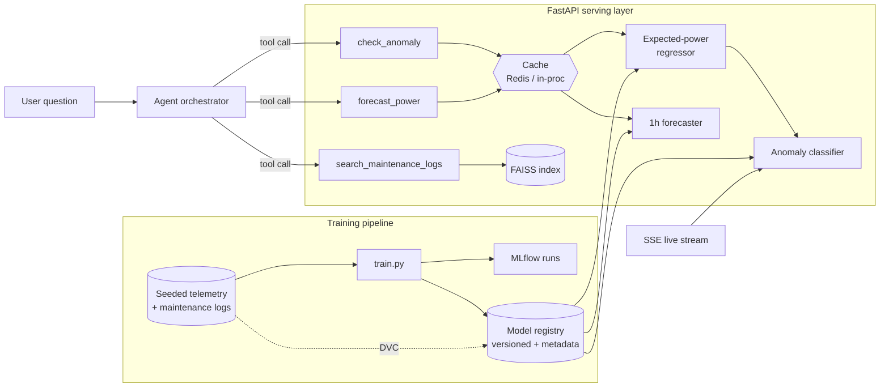

# PlantPulse

**An agentic analytics service over renewable-energy plant telemetry.** Ask a question in plain English ("is anything wrong with wind-02, and have we seen it before?"). An agent routes it to production ML components (an anomaly detector, a 1-hour power forecaster, and semantic search over past maintenance logs) and answers with a full trace of the tool calls it made.

The focus is the engineering around the models rather than the models themselves: serving, latency, caching, provenance, evaluation gates, and CI/CD. The domain draws on my background building SCADA commissioning and network-management systems for solar and wind plants.


*The live replay above shows an inverter fault: actual output (blue) tracks about half the expected curve (dashed) all day, and the model flags each affected reading (red) as it streams.*

---

## Architecture



Anomaly detection is **two-stage**. A regressor learns what a *healthy* site should produce given weather and sensor inputs. A classifier then works on the residual (actual minus expected) together with drift and vibration features. This structure is what lets the system separate real faults from **grid curtailment**, where output is low on purpose. A naive "power dropped" rule can't make that distinction.

## Measured results

All numbers come from a held-out, time-based split (the last 20% of the timeline, so no future data leaks into training). Each one is re-checked by the regression gate on every CI run.

| Component | Model | Naive baseline | Lift |
|---|---|---|---|
| Anomaly detection | **F1 0.666** (P 0.81 / R 0.57, ROC-AUC 0.80) | static threshold rule: F1 0.177 | **3.8x F1** |
| 1-hour power forecast | **MAE 54 kW** | persistence ("next = now"): MAE 143 kW | **62% lower error** |
| Expected-power model | MAE 17 kW on 1.5–3.2 MW sites | – | – |

| Serving performance | Before | After | Change |
|---|---|---|---|
| `predict_anomaly` p50 latency | 73 ms | **~10 ms** | 7x faster: per-site index + `n_jobs=1` for single-row inference |
| `predict_anomaly` p95 latency | 89 ms | **~15–17 ms** | |
| Batch re-scoring (69k rows) | 94 rows/s (row loop) | **85k rows/s** (vectorized) | ~900x |
| …plus 2-process pool | | 98k rows/s | 1.14x more (bounded by 2 cores and IPC overhead) |

The regression check caught the latency problem and a real agent-routing bug ("have we seen this *vibration* before" wasn't reaching log search). Both were fixed, and the fixes are locked in as tests.

## How this maps to the role

| Responsibility | Where it lives |
|---|---|
| Integrate ML into production pipelines and APIs | `app/` FastAPI service; models load once at startup through a registry |
| Optimize latency, throughput, memory | Measured latency fix above; `ml/benchmark_parallel.py` (naive vs vectorized vs process pool, results asserted identical) |
| Model-serving infrastructure (API, batch, streaming) | REST endpoints, `/predict/batch`, and **SSE `/stream/telemetry`** running live per-event inference |
| Testing and validation frameworks for ML | `tests/`: feature-skew, leakage, API-contract and agent tests (25) |
| Caching and provenance for models, code and data | Redis/in-process prediction cache; **DVC** for data and artifacts; registry `metadata.json` per model version (data hash, git commit, features, metrics); **MLflow** for runs |
| CI/CD for model deployment | `.github/workflows/ci.yml`: rebuild from source, then tests, then regression gate, then image build and container smoke test, then deploy |
| Regression testing to monitor the analytics engine | `ml/regression_check.py`: quality, p95 latency, agent-routing accuracy and data contract against a committed baseline, with run history for trends |
| Vector DBs / embeddings | FAISS index behind an `Embedder` interface (see the honest note below) |
| Agent layer integration | `agent/`: Anthropic tool-use loop, plus a deterministic fallback that calls the *same* tools |

## Run it

```bash
make install         # pip install -r requirements-dev.txt
make pipeline        # generate seeded data -> train (MLflow) -> build vector index
make test            # 25 tests
make regress         # regression gate vs ml/regression_baseline.json
make serve           # http://localhost:8000  (UI at /, API docs at /docs)
```

With Docker (adds Redis as the shared cache):

```bash
docker compose up --build    # http://localhost:8000
```

To run the agent in **LLM tool-use mode**, set `ANTHROPIC_API_KEY`. Without a key it falls back to a deterministic rule-based planner over the same tools, which keeps it fully runnable offline and testable in CI.

## Deploy (free public URL)

**Hugging Face Spaces (recommended: 16 GB RAM on the free CPU tier):**
1. Create a Space at huggingface.co/new-space and choose **Docker** as the SDK.
2. In this GitHub repo, add the secret `HF_TOKEN` (a write token) and the variable `HF_SPACE` (for example `your-username/plantpulse`).
3. Push to `main`. CI deploys automatically, but only after tests and the regression gate pass.

**Render (alternative):** New, then Blueprint, then select this repo; `render.yaml` handles the rest. The free tier has 512 MB of RAM and the service peaks around 330 MB.

## Design decisions and honest limitations

- **Synthetic data.** The telemetry is generated with physically motivated power curves and seeded, injected faults (inverter faults, sensor drift, mechanical wear) plus benign curtailment. Seeding makes the whole pipeline reproducible: a cold rebuild in CI yields bit-identical metrics, which the regression gate verifies.
- **Embeddings.** The sandbox this was built in blocked model downloads, so the default embedder is TF-IDF plus truncated SVD (offline and deterministic). A neural embedder (`FastEmbedEmbedder`, bge-small) sits behind the same interface and is a one-line swap.
- **Features are precomputed at startup** as a stand-in for a streaming feature pipeline. The serving contract (the model is called at request time, one row per request) is real. In production I'd move feature computation into a streaming job and an online feature store.
- **The LLM agent path** is implemented against Anthropic's tool-use API but isn't exercised in CI, which runs without credentials. The rule-based path calls the same tool functions and is fully tested.
- **Parallelism.** On a 2-core runner, vectorization is the lever that matters, and the process pool adds only about 14%. The benchmark exists to *measure* that rather than assume parallelism helps.

## Roadmap

Multi-horizon forecasts with prediction intervals · drift monitoring on live feature distributions · ONNX export for the classifier · a streaming feature pipeline (Kafka) · LLM-judged evals for agent answer quality, not just routing.

## Layout

```
app/       FastAPI service: registry, cache, inference, SSE stream, UI
agent/     tool specs + orchestrator (Anthropic tool-use / rule-based fallback)
ml/        data generation, features, training, vector store, benchmark, regression gate
tests/     feature, API-contract and agent tests
infra/     deployment helpers
```
